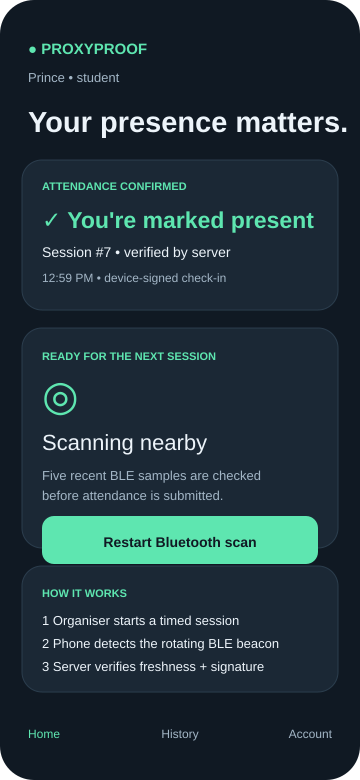
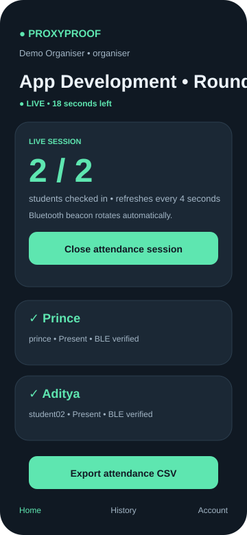

# ProxyProof — Secure Bluetooth Attendance

ProxyProof is a native Android attendance prototype that replaces roll calls, QR codes and shared attendance PINs with a **short-lived BLE proximity signal + server verification + device-bound student identity**.

An organiser starts a timed session and broadcasts a rotating BLE beacon. Student phones listen in the foreground, collect multiple recent RSSI samples, and submit a signed attendance request to the backend. The organiser sees the roster update automatically and can export a CSV.

> **Status:** working end-to-end prototype. The demonstrated flow has been run with separate organiser and student Android phones: session broadcast → BLE detection → five RSSI samples → signed server check-in → organiser dashboard marked present.

## Product preview

<table>
<tr>
<td width="50%"></td>
<td width="50%"></td>
</tr>
<tr>
<td align="center"><b>Student</b> — automatic check-in + clear server confirmation</td>
<td align="center"><b>Organiser</b> — live roster, session controls and CSV export</td>
</tr>
</table>

## Why ProxyProof

| Problem | ProxyProof approach |
|---|---|
| Roll calls waste class time | Automatic foreground BLE check-in |
| QR/PIN codes can be shared | No attendance code is shown to students |
| Static Bluetooth identifiers can be replayed | Server-issued beacon token rotates and expires quickly |
| One account may be copied across installations | Student public key is bound on first login |
| Client-only attendance can be forged | Attendance is accepted only by the backend after validation |
| Organisers need corrections | Manual add/remove requires a reason and is audited |

## Demo flow

1. Start the Python backend on a laptop accessible to both phones.
2. Sign in on one Android phone as an **organiser**.
3. Sign in on another Android phone as a **student**.
4. On the organiser phone, create a session with a duration and RSSI threshold.
5. Tap **Start session & broadcast**.
6. Keep the student app open near the organiser phone.
7. ProxyProof collects at least five recent BLE RSSI samples from one rotating token.
8. The student app submits a device-signed attendance request.
9. The backend validates session freshness, beacon freshness, roster membership, RSSI and signature.
10. The organiser dashboard refreshes automatically and shows the student as **BLE verified**.
11. Close the session to view the final summary and export the attendance CSV.

## Features

### Student experience

- Device-bound student identity using Android Keystore P-256 keys
- Foreground automatic BLE scanning
- Five-sample proximity check before submission
- Clear **Attendance confirmed** success card after server acceptance
- Attendance history and overall percentage
- Device-change request flow when moving to another installation

### Organiser experience

- Create fixed-duration attendance sessions
- Configurable RSSI threshold
- Rotating BLE beacon while the session is live
- Live present/total count with automatic refresh
- Human-readable roster states such as **BLE verified** and **Manual correction**
- Final session summary with present, absent and attendance percentage
- Manual corrections with required reason
- CSV export through Android's document picker

### Backend/security

- Python standard-library HTTP server + SQLite
- Password hashing with `hashlib.scrypt`
- Expiring authentication tokens
- P-256 ECDSA verification for student requests
- Signed timestamp + nonce + request-body hash
- Replay-nonce tracking
- Short-lived rotating beacon tokens
- Server-side role checks
- Login attempt limiting
- Audit records for sensitive changes

## Architecture

```text
┌──────────────────────┐             ┌──────────────────────┐
│ Organiser Android    │             │ Student Android      │
│                      │   BLE       │                      │
│ Session dashboard    │ ─────────▶  │ Low-latency scanner  │
│ Rotating advertiser  │             │ Keystore P-256 key   │
└──────────┬───────────┘             └──────────┬───────────┘
           │ HTTPS / trusted LAN HTTP           │ signed request
           └──────────────────┬─────────────────┘
                              ▼
                    ┌──────────────────────┐
                    │ ProxyProof backend   │
                    │ Python + SQLite      │
                    │ auth / sessions /    │
                    │ beacons / attendance│
                    └──────────────────────┘
```

More detail: [Architecture](docs/ARCHITECTURE.md) · [Testing](docs/TESTING.md) · [Setup guide](docs/START_HERE.md)

## Quick start

### 1. Backend

```bash
cd backend
python -m pip install -r requirements.txt
python server.py init
python server.py add-user teacher "Demo Organiser" organiser
python server.py add-user student01 "Demo Student" student
python server.py serve --host 0.0.0.0 --port 8000
```

Each `add-user` command securely prompts for a password of at least 10 characters.

Check the backend from the laptop:

```text
http://127.0.0.1:8000/health
```

For physical-phone testing, connect the laptop and phones to a network that permits device-to-device traffic, then use the laptop's LAN IP in the app, for example:

```text
http://192.168.x.x:8000
```

> `10.0.2.2` is the Android Emulator alias for the host machine; do not use it from a real phone.

### 2. Android build

```bash
cd android
./gradlew assembleDebug
```

Windows:

```bat
gradlew.bat assembleDebug
```

APK output:

```text
android/app/build/outputs/apk/debug/app-debug.apk
```

The GitHub Actions workflow also builds and verifies the APK automatically.

## Permissions required for the demo

Keep the app in the foreground and allow:

- Nearby devices / Bluetooth scan
- Bluetooth advertise on the organiser phone
- Bluetooth connect
- Location where Android requires it for BLE scanning
- Network access to the backend

The organiser phone must support BLE advertising.

## Session behaviour

A session snapshots the currently provisioned student roster **when the session is created**. If you add another student later, close the old session and start a new one so the new student appears in the roster.

The default demonstration values are:

```text
Duration:       5 minutes
RSSI threshold: -70 dBm
```

RSSI is intentionally configurable because radio conditions vary across phones and rooms.

## Threat-model boundary

ProxyProof is a **proximity attendance prototype**, not a production anti-fraud guarantee.

The current design raises the bar above shared codes by combining a rotating server token, device-bound signing, request freshness and BLE signal checks. However, RSSI is noisy, a sufficiently capable relay can forward radio traffic, rooted/modified clients are outside the current trust boundary, and an Android Keystore key identifies an app installation rather than proving a globally unique physical handset.

Present these limitations clearly in evaluation or recruitment demos.

## Repository layout

```text
android/                 Native Android app
backend/server.py        API, SQLite schema and provisioning CLI
backend/test_server.py   Backend tests
docs/                    Setup, architecture, testing and UI previews
.github/workflows/       Build verification + emulator render workflow
releases/                Demo APK when included
```

## Submission/demo checklist

- [ ] Backend starts and `/health` responds
- [ ] Organiser login succeeds
- [ ] Student login succeeds
- [ ] Nearby/Bluetooth permissions are granted
- [ ] Organiser starts a live session
- [ ] Student is automatically marked through BLE
- [ ] Organiser dashboard shows **BLE verified**
- [ ] Session closes and displays final summary
- [ ] CSV export works
- [ ] Short two-phone demo video is recorded
- [ ] Threat-model limitations are explained accurately

## Tech stack

- **Android:** Java, Android framework UI, BLE scanner/advertiser, Android Keystore
- **Backend:** Python 3, SQLite, `cryptography`
- **Build:** JDK 17, Gradle 8.9, Android Gradle Plugin 8.7.3
- **CI:** GitHub Actions

---

**ProxyProof** — be present, be counted.
